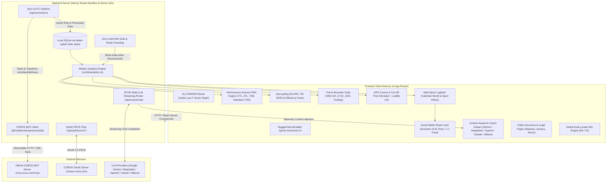

# System Architecture, Features & Scientific Formulas

Comprehensive technical documentation covering system architecture, data flow, feature specifications, mathematical equations, and sports science references implemented in **ALLTERRAIN** (formerly my-coros-app).

---

## 1. High-Level System Architecture

The application is engineered as a modern, local-first athletic telemetry platform combining **Next.js 16 (Turbopack + App Router) + Local SQLite WAL Storage + Official COROS MCP Client + BYOK Multi-LLM AI Router + Social Share Card Exporter**.

---

## 2. Data Layer & SQLite Schema (WAL Mode & Turso Edge LibSQL)

Data is stored locally on-disk at `./data/coros_athlete.db` using `@libsql/client` configured with **WAL (*Write-Ahead Logging*)** for local development, or connected seamlessly to **Turso Edge Database** via `TURSO_DATABASE_URL` and `TURSO_AUTH_TOKEN` in serverless/production deployments.

### 2.1 Table Specifications (`src/lib/db.ts`)

| Table Name | Description | Primary Key / Unique |
| :--- | :--- | :--- |
| `auth_tokens` | Stores COROS OAuth 2.0 access & refresh tokens, expiration timestamps, scopes, and athlete profile metadata. | `id` (athlete_id) |
| `sessions` | Serverless multi-tenant session storage mapping session cookies/headers to `athlete_id`. | `session_id` |
| `oauth_states` | Ephemeral store for PKCE `code_verifier` and security states during the OAuth handshake. | `state` |
| `activities` | Workout sessions (road runs, trail runs, track, bike, gym/strength) including distance, duration, elevation, heart rate, VAM, TE, and raw sensor streams. | `id` (standard `act_${coros_id}`), UNIQUE `(athlete_id, coros_id)` |
| `daily_metrics` | Daily time-series records of Training Load, CTL, ATL, TSB, ACWR, Monotony, Strain, HRV rMSSD, and Sleep data. | `(athlete_id, date)` |
| `chat_messages` | Full conversational memory history with the context-aware AI Training Coach. | `id` (UUID) |
| `user_settings` | BYOK configuration (LLM API keys, chosen models, VAM calibrations, athlete body mass, threshold pace). | `(athlete_id, key)` |

### 2.2 Deduplication Engine & Constraint Safeguards
- **Deterministic Activity Ranking (`cleanDuplicateActivities`):** Employs windowed SQL partition ranking (`ROW_NUMBER() OVER (PARTITION BY athlete_id, COALESCE(NULLIF(coros_id, ''), start_time) ORDER BY CASE WHEN raw_data LIKE '%Activity Details%' THEN 1 ELSE 0 END DESC, CASE WHEN id = 'act_' || coros_id THEN 1 ELSE 0 END DESC, created_at DESC)`) to automatically prune duplicate workout rows from legacy transition states.
- **Unique Composite Indexes:** `idx_activities_athlete_coros` (`athlete_id`, `coros_id`) and `idx_user_settings_athlete_key` (`athlete_id`, `key`) prevent duplicate workout records and cross-athlete configuration collisions at the engine level.
- **Incremental Sync Engine (7-Day Sliding Window):** Instead of requesting 90 days on every invocation, the sync engine queries the athlete's latest workout timestamp in the database and requests only `[latest_activity - 7 days, today]`. This eliminates 95% of remote payload overhead, captures late-synced workouts or watch metadata edits, and falls back to a 90-day baseline only on empty initial athlete syncs.
- **Concurrent Wellness Pipeline (`Promise.allSettled`):** Concurrently dispatches all 6 independent wellness & assessment queries (`queryFitnessAssessmentOverview`, `queryRecoveryStatus`, `queryTrainingLoadAssessment`, `queryDailyHealthData`, `queryRestingHeartRate`, `querySleepHrv`) in parallel, reducing initial MCP latency by 75%.
- **Atomic Batch PMC Writes (`db.batch`):** Collects all 98 continuous daily metrics statements into a single atomic batch payload, collapsing 98 sequential remote network round-trips into 1 single HTTP request (~100ms on Turso edge).
- **Sync Purge Pre-check & Batch Preload:** Preloads existing workout IDs and barometric detail cache in 1 query, skipping unchanged workouts via fast-path in-memory checks.

---

## 3. Comprehensive Feature Catalog

### 3.1 Brand Identity & UI Design System
- **Brand Mark:** **`ALLTERRAIN`** with mathematical vector glyph `▲LT` (`src/app/icon.svg`) representing the summit and horizon.
- **Neo-Brutalist Rugged Aesthetics:** High-contrast borders (`border-2 border-zinc-950`), solid shadows (`shadow-[3px_3px_0px_0px_#09090b]`), bold typography, and warm retro chalk tones (`#F6F4EE`).

### 3.2 Performance Science PMC Engine
- **Bannister Impulse-Response Engine:** Interactive continuous curves for Fitness (CTL), Fatigue (ATL), and Form (TSB).
- **Dual Scale Architecture:** Toggle seamlessly between:
  - **COROS TRIMP Scale:** Raw cardiac impulse matching the COROS watch screen.
  - **Standard rTSS Scale:** Coggan / Friel functional threshold pace-calibrated workload model.
- **Form Zones Classification:** 5 actionable training states (*High Risk Overreaching*, *Optimal Training*, *Grey/Maintenance*, *Fresh/Race Ready*, and *Transition/Detraining*).
- **Ramp Rate Safeguard:** 7-day rolling CTL delta tracking to prevent bone, tendon, and ligament stress injuries from rapid volume spikes.

### 3.3 Multi-Sport Architecture
Supports comprehensive telemetry across major endurance and fitness disciplines:
- **Road Running:** Distance, duration, pace (`min/km`), average/max heart rate, cadence, training load, aerobic/anaerobic TE.
- **Authentic Altimetry & Workout Telemetry:** Uses the official COROS MCP `getActivityDetail` tool to capture exact barometric Elevation Gain and Loss (`Elevation Gain / Loss: X m / Y m`), eliminating synthetic flat-distance multipliers. Caches full telemetry payloads in SQLite `raw_data` to preserve instantaneous zero-latency subsequent syncs.
- **Heart Rate Telemetry:** Prioritizes native Max/Peak HR from COROS records (`querySportRecords`), with automatic physiological extrapolation fallback ($\text{Avg HR} \times 1.12$ for road running, $\text{Avg HR} \times 1.16$ for mountain trail sessions) when summary payloads only provide Average Heart Rate.
- **Trail Running:** VAM climbing rate, cumulative D+/D-, ITRA Km-Effort, Effort Pace (GAP), and Aerobic Decoupling ($Pa:HR$). Mountain dynamics card automatically hides for flat road sessions ($\le 150\text{m}$ D+).
- **Cycling / Bike:** Speed calculation in `km/h`, cycling load, and cadence.
- **Gym / Strength Training:** Duration, workout sets, TRIMP load, peak HR, and aerobic/anaerobic training effect without erroneous pace calculations.

### 3.4 Calendar Month & Multi-Sport Logbook (`/activities`)
- **Dynamic Calendar Month Extraction:** Extracts distinct months (e.g. *Agustus 2026*, *Juli 2026*) dynamically from recorded activities.
- **Dynamic KPI Summary Cards:** Selecting a specific month automatically recalculates total distance, elevation D+, training hours, TRIMP load, and sport breakdown for that specific month alone.
- **Multi-Select Sport Filter:** Independent or combined selection of `Road Run`, `Trail Run`, `Sepeda`, and `Gym / Strength`.
- **Quick Presets:** Instant range toggles for `Semua Waktu`, `6 Bulan`, `1 Tahun`, and `1-Click Reset Semua Filter`.

### 3.5 Social Media Share Card Exporter (`ActivityShareModal`)
- **Format Toggle:**
  - **📱 9:16 (Instagram Story):** 1080×1920 high-res format with large visualizer and clear metrics.
  - **⏹️ 1:1 (Instagram Feed / Square):** 1080×1080 post format.
- **Visual Themes:**
  - **🌙 Dark Onyx:** Matte black background with electric neon accents (orange/emerald/cyan).
  - **☀️ Neo Chalk:** High-contrast warm off-white with thick solid borders.
- **Intelligent Sport Visualizer:**
  - **Run & Bike:** High-resolution SVG route path with glowing start dot (emerald) and finish marker (orange) + D+ elevation badge.
  - **Gym / Strength:** Cardio & Heart Rate Waveform (SVG) with peak HR callout (`▲ Peak 171 bpm`), average baseline guide line, and training effect tags.
- **Export Capabilities:** 1-click **Download PNG (3x Retina)** and **Copy to Clipboard**.

### 3.6 ACWR & Injury Prevention Suite (Gabbett & Foster)
- **Acute:Chronic Workload Ratio (ACWR):** Evaluates short-term stress against chronic preparedness.
  - `< 0.8`: *Under-training* (Fitness decay risk)
  - `0.8 - 1.3`: *Sweet Spot* (Optimal physiological adaptation, lowest relative injury risk)
  - `1.3 - 1.5`: *Warning Zone* (Rapid load accumulation)
  - `> 1.5`: *Danger Zone* (Injury risk spikes 2x to 4x)
- **Training Monotony & Strain:** Carl Foster's index detecting workout monotony without adequate micro-cycle deloading.

### 3.7 Physiological Efficiency & Polarized 80/20 Distribution
- **Aerobic Decoupling ($Pa:HR$ / Cardiac Drift %):** Evaluates cardiac drift between the 1st half and 2nd half of steady-state workouts to confirm aerobic mitochondrial base.
- **Efficiency Factor ($EF$):** Longitudinal metric calculating speed produced per single heart beat ($Speed / HR$).
- **Training Intensity Distribution (TID 80/20):** Classifies weekly volume into Low Intensity (Z1-Z2), Threshold (Z3), and High Intensity (Z4-Z5) to prevent athletes from stagnating in the *"Zone 3 Black Hole"*.

### 3.8 Ultra Trail & Mountain Running Suite
- **VAM (Velocità Ascensionale Media):** Climbing speed normalized to vertical meters gained per hour ($m/h$).
- **Climb Density Profiling:** Categorization of elevation gain per horizontal distance ($m D+/km$) inspired by Kilian Jornet and *Uphill Athlete*.
- **Aerobic Deficiency Syndrome (ADS) Diagnostic:** Diagnostic gap analysis between Aerobic Threshold (AeT) and Anaerobic Threshold (AnT).
- **Scientific Fueling & Hydration Planner:** Evidence-based exogenous carbohydrate ($g/h$), water intake ($L/h$), and sodium replenishment ($mg/h$) targets.

### 3.9 GPX Course & Cut-Off Time (COT) Simulator (`/trail-planner`)
- **Client-Side GPX Parser:** Instant extraction of GPS coordinates (`<trkpt>`) and official checkpoint aid stations (`<wpt>`).
- **Interactive Leaflet Topographic Map:** Geospatial mapping (OpenTopoMap, Esri World Imagery, OpenStreetMap) featuring synchronized bidirectional cursor tracking between the elevation profile and spatial radar beacon.
- **Multi-Colored Elevation Cross-Section:** Real-time terrain slope coloring (Green: Flat, Lime: Gentle, Yellow: Moderate, Orange: Power-Hike, Red: Extreme Wall >25%, Cyan: Descent, Purple: Technical Descent).
- **Segment Breakdown & Major Mountain Passes:** Automatic identification of categorized climbs (HC, Cat 1, Cat 2, Cat 3) with gradient stats and estimated climbing time.
- **Scientific Cut-Off Time (COT) Simulation:** Advanced model accounting for night headlamp visibility penalties, high-altitude hypoxia (>2,200m), second-half fatigue degradation, and aid-station rest buffers.
- **Printable Wristband Pace Card:** Print-optimized format for physical wristband laminated cheat-sheets on race day.

### 3.10 BYOK AI Training Coach (Multi-LLM with DeepSeek)
- Interactive AI coaching drawer with direct access to current athlete telemetry: live TSB, ACWR status, daily HRV, historical VAM, and recent workout streams.
- **Multi-Provider BYOK Architecture:**
  - **Google Gemini:** `gemini-2.5-flash`
  - **DeepSeek:** `deepseek-chat` (DeepSeek-V3 / DeepSeek-R1 via OpenAI-compatible API)
  - **OpenAI:** `gpt-4o`, `gpt-4o-mini`
  - **Anthropic Claude:** `claude-3-5-sonnet-20241022`
  - **Ollama (Local):** `llama3.2`, `mistral`

### 3.11 Hardened Security & Disconnect Privacy
- **Zero Data Leak on Disconnect:**
  - When disconnected (`!isConnected`), `/api/analytics/dashboard` returns empty sets (`activities: []`, `pmcSeries: []`).
  - Attempting to visit protected routes (`/activities`, `/trail-planner`) triggers an immediate redirect to `/`.
  - The Header automatically hides all internal navigation links, AI Coach trigger, Settings button, and Online/Offline badges, leaving only the clean brand mark.
  - The landing page renders a secure `<AuthGate />` locking all telemetry until reconnected, accompanied by the public universal footer.
  - Upon successful authentication (`isConnected === true`), the public footer is intentionally omitted from the athletic dashboard shell (`!isConnected && <Footer />`) to eliminate visual noise and maintain an uncluttered telemetry instrument view.

### 3.12 Public Information Architecture & Transparent Methodology (`/features`)
- **Unauthenticated Public Route:** Serves a comprehensive breakdown of all 7 core sports science engines without requiring COROS OAuth credentials.
- **Architectural Pillars Detailed:**
  1. Banister Impulse-Response Model & EMA time-constants (42d CTL / 7d ATL).
  2. Tim Gabbett ACWR sweet spot ($0.8 - 1.3$) and adaptive safety downshifting.
  3. Stephen Seiler 80/20 polarized distribution and grey-zone threshold stagnation prevention.
  4. Mountain VAM climbing velocity ($m/h$), GPX parsing, and hydration/carbohydrate pacing.
  5. Joe Friel Aerobic Decoupling ($Pa:HR$) and split-by-split workout compare.
  6. BYOK multi-provider AI Coach prompt context injection architecture.
  7. Local-first zero-knowledge privacy and official COROS MCP integration.
- **Conversion Pathways:** Includes direct connect CTA button (`/api/auth/coros/login`) and manual Bearer Token drawer.

### 3.13 Legal Framework & Regulatory Compliance (`/privacy`, `/terms`)
- **Privacy Policy (`/privacy`):**
  - Explicitly states zero-knowledge local SQLite storage, encryption-at-rest for athlete OAuth tokens, and zero monetization or third-party telemetry brokering.
  - Documents BYOK AI privacy (API keys communicated directly with LLM providers; never intercepted or logged).
  - Specifies full data sovereignty with 1-click token purge via Disconnect.
- **Terms of Service (`/terms`):**
  - **Essential Non-Medical Disclaimer:** Legally specifies that all algorithmic calculations (PMC, ACWR, VAM, cardiac drift, and fueling) are sports science estimations intended strictly for educational and athletic performance purposes, not licensed medical advice.
  - **COROS Platform Compliance:** Clarifies independent operation via official COROS Open API / MCP protocols and non-affiliation trademark disclaimers.
  - **Developer Contact:** Official channel directed to Muhammad Farid Zia (`muhfaridzia@gmail.com`).

### 3.14 Global Internationalization (i18n) Engine
- **Client-Side Reactive Context (`src/lib/i18n/`):**
  - `LanguageContext.tsx`: Manages active language state (`en` | `id`), provides the `t(path, fallback)` translation helper, and handles browser `localStorage` persistence (`allterrain_language`).
  - `translations.ts`: Single-source-of-truth bilingual dictionary covering navigation, metrics, tooltips, form zones, workout logbook, trail planner, AI coach, features showcase, and legal disclaimers.
  - Synchronizes HTML document `lang` attribute dynamically (`<html lang="id">` or `<html lang="en">`).

### 3.15 Universal Footer Architecture (`<Footer />`)
- Standardized neo-brutalist footer component integrated across all public (`/`, `/features`, `/privacy`, `/terms`) and authenticated dashboard views.
- Features direct cross-navigation links (`Overview`, `Features & Science`, `Privacy Policy`, `Terms of Service`) and official community attribution:
  *“© 2026 ALLTERRAIN. Developed for the COROS user community. Not affiliated with COROS Wearables Inc.”*

---

## 4. Scientific Formulas & Mathematical Models

### 4.1 Performance Management Chart (PMC) — Bannister Impulse-Response

Continuous exponential moving average (EMA) formulation:

$$\text{CTL}_{\text{today}} = \text{CTL}_{\text{yesterday}} \times e^{-1/42} + \text{Load}_{\text{today}} \times (1 - e^{-1/42})$$

$$\text{ATL}_{\text{today}} = \text{ATL}_{\text{yesterday}} \times e^{-1/7} + \text{Load}_{\text{today}} \times (1 - e^{-1/7})$$

$$\text{TSB} = \text{CTL} - \text{ATL}$$

$$\text{Form \%} = \left(\frac{\text{TSB}}{\text{CTL}}\right) \times 100\%$$

$$\text{Ramp Rate} = \text{CTL}_{\text{today}} - \text{CTL}_{\text{7 days ago}}$$

- **CTL Decay Constant ($\lambda_{ctl}$):** $e^{-1/42} \approx 0.97647$ (42-day time constant).
- **ATL Decay Constant ($\lambda_{atl}$):** $e^{-1/7} \approx 0.86688$ (7-day time constant).

---

### 4.2 Running Training Stress Score (rTSS)

Calculated per workout against the athlete's functional threshold pace (Joe Friel / Andy Coggan):

$$\text{Intensity Factor (IF)} = \frac{\text{Threshold Pace (sec/km)}}{\text{Grade Adjusted Pace (sec/km)}}$$

$$\text{rTSS} = 100 \times \text{Duration (hours)} \times \text{IF}^2$$

---

### 4.3 Acute:Chronic Workload Ratio (ACWR) — Tim Gabbett (2016)

$$\text{Acute Load} = \sum_{i=0}^{6} \text{Load}_{t-i} \quad (\text{Past 7 days accumulated load})$$

$$\text{Chronic Weekly Avg} = \left(\frac{1}{28} \sum_{i=0}^{27} \text{Load}_{t-i}\right) \times 7 \quad (\text{Normalized 7-day equivalent of 28-day load})$$

$$\text{ACWR} = \frac{\text{Acute Load}}{\text{Chronic Weekly Avg}}$$

---

### 4.4 Training Monotony & Strain — Carl Foster (1998)

Assesses workout variability over a 7-day micro-cycle:

$$\mu = \frac{1}{7} \sum_{i=1}^{7} \text{Load}_i \quad (\text{Mean Daily Load})$$

$$\sigma = \sqrt{\frac{1}{7} \sum_{i=1}^{7} (\text{Load}_i - \mu)^2} \quad (\text{Standard Deviation of Daily Load})$$

$$\text{Monotony} = \frac{\mu}{\sigma} \quad (\text{Safe Threshold: } \le 2.0)$$

$$\text{Training Strain} = \left(\sum_{i=1}^{7} \text{Load}_i\right) \times \text{Monotony}$$

---

### 4.5 Aerobic Decoupling ($Pa:HR$ / Cardiac Drift %) — Joe Friel

Evaluates aerobic endurance stability by comparing speed-to-heart rate efficiency between the first and second halves of a workout:

$$\text{EF}_1 = \frac{\text{Speed}_{\text{half 1}} \ (\text{m/s})}{\text{HR}_{\text{half 1}} \ (\text{bpm})}, \quad \text{EF}_2 = \frac{\text{Speed}_{\text{half 2}} \ (\text{m/s})}{\text{HR}_{\text{half 2}} \ (\text{bpm})}$$

$$\text{Decoupling \%} = \left(\frac{\text{EF}_1 - \text{EF}_2}{\text{EF}_1}\right) \times 100\%$$

- **Clinical Interpretation:**
  - $\le 5.0\%$: Solid aerobic base (*Aerobic Base Solid*).
  - $> 5.0\%$: Meaningful *Cardiac Drift* (dehydration, glycogen depletion, or thermoregulatory fatigue).

---

### 4.6 Velocità Ascensionale Media (VAM) — Dr. Michele Ferrari

Measures net vertical climbing speed:

$$\text{VAM} \ (m/h) = \left(\frac{\text{Elevation Gain} \ (m)}{\text{Climbing Duration} \ (\text{seconds})}\right) \times 3600$$

---

### 4.7 ITRA Km-Effort — International Trail Running Association / World Athletics

Standard physiological effort metric for trail races:

$$\text{Km-Effort} = \text{Distance} \ (\text{km}) + \frac{\text{Elevation Gain D+} \ (m)}{100}$$

---

### 4.8 ITRA Mountain Level (0 to 12 Scale)

Computed via climb density ratio and summit altitude:

$$\text{Density Ratio} = \frac{\text{Total D+} \ (m)}{\text{Total Distance} \ (\text{km})}$$

- $\text{Density Ratio} < 25 \ m/\text{km} \rightarrow$ Level 1–2
- $25 \le \text{Density Ratio} < 45 \ m/\text{km} \rightarrow$ Level 3–4
- $45 \le \text{Density Ratio} < 65 \ m/\text{km} \rightarrow$ Level 5–6
- $65 \le \text{Density Ratio} < 85 \ m/\text{km} \rightarrow$ Level 7–8
- $85 \le \text{Density Ratio} < 105 \ m/\text{km} \rightarrow$ Level 9–10
- $\text{Density Ratio} \ge 105 \ m/\text{km}$ or summit elevation $> 3,000m \rightarrow$ Level 11–12 (*Extreme Alpine / Skyrunning*)

---

### 4.9 Checkpoint Cut-Off Time (COT) Allocation Model

Prevents linear pacing errors on mountainous courses using a non-linear front-loaded effort exponent:

$$\text{Effort Ratio}_i = \frac{\text{Cumulative Km-Effort at Checkpoint}_i}{\text{Total Course Km-Effort}}$$

$$\text{COT Checkpoint}_i \ (\text{hours}) = (\text{Effort Ratio}_i)^{0.88} \times \text{Official Race Cut-Off Limit}$$

---

### 4.10 Hybrid Naismith & Minetti Mountain Pacing Model

Segment transit duration is estimated through a multi-factor physiological model:

$$T_{\text{segment}} = T_{\text{flat}} + T_{\text{climb}} + T_{\text{descent}} + T_{\text{altitude}} + T_{\text{night}} + T_{\text{fatigue}} + T_{\text{aid}}$$

1. **Flat Horizontal Component:**
   $$T_{\text{flat}} = \Delta \text{Distance} \ (\text{km}) \times \text{Flat Pace} \ (\text{sec/km}) \times K_{\text{terrain}}$$
   *(where $K_{\text{terrain}} \approx 1.12$ for rugged technical trail)*.

2. **Vertical Climbing Component (Personal VAM):**
   $$T_{\text{climb}} = \frac{\Delta D+ \ (m)}{\text{VAM} \ (m/h)} \times 3600$$

3. **Descent Component (Minetti Eccentric Quad Braking):**
   $$T_{\text{descent}} = \left(\frac{\Delta D- \ (m)}{1000}\right) \times K_{\text{quad}}$$

4. **Altitude Hypoxia Degradation:**
   - Elevation $2,200m - 3,000m$: VAM degraded by $-6\%$.
   - Elevation $> 3,000m$: VAM degraded by $-12\%$.

5. **Headlamp Night Visibility Penalty:**
   - Between 18:00 and 06:00: Pacing slowed by $+16\%$.

6. **Second-Half Glycogen & Muscular Fatigue:**
   - Beyond $30\%$ of total course distance: Pacing degrades progressively by $+14\%$.

---

### 4.11 Endurance Fueling & Hydration (Jeukendrup 2014 & Costa 2019)

$$\text{Carbohydrates} \ (g/h) = \begin{cases} 45 \ g/h & \text{if } H < 2.5 \\ 60 \ g/h & \text{if } 2.5 \le H < 5.0 \\ 75 \ g/h & \text{if } H \ge 5.0 \end{cases}$$

$$\text{Fluid Intake} \ (ml/h) = 600 \ ml/h$$

$$\text{Sodium Intake} \ (mg/h) = 500 \ mg/h \quad (\approx 1 \text{ salt capsule per hour})$$

$$\text{Energy Gels Required} = \left\lceil \frac{\text{Total Carbohydrates} \ (g)}{25 \ g/\text{gel}} \right\rceil$$

---

## 5. Scientific References & Citations

1. **Bannister, E. W. (1991).** *Modeling Elite Athletic Performance.* Physiological Testing of the High-Performance Athlete (pp. 403-424). Human Kinetics.
2. **Gabbett, T. J. (2016).** *The training—injury prevention paradox: should athletes be training smarter and harder?* British Journal of Sports Medicine, 50(5), 273-280.
3. **Foster, C. (1998).** *Monitoring training in athletes with reference to overtraining syndrome.* Medicine & Science in Sports & Exercise, 30(7), 1164-1168.
4. **Friel, J. (2009).** *The Cyclist's Training Bible & Total Heart Rate Training.* VeloPress.
5. **Seiler, S. (2010).** *What is best practice for training intensity and duration distribution in endurance athletes?* International Journal of Sports Physiology and Performance, 5(3), 276-291.
6. **Minetti, A. E., et al. (2002).** *Energy cost of walking and running at extreme uphill and downhill slopes.* Journal of Applied Physiology, 93(3), 1039-1046.
7. **Jeukendrup, A. (2014).** *A step towards personalized sports nutrition: carbohydrate intake during exercise.* Sports Medicine, 44(1), 25-33.
8. **Costa, R. J., et al. (2019).** *Nutrition for ultra-endurance running: Trail and ultramarathons.* International Journal of Sport Nutrition and Exercise Metabolism, 29(2), 130-140.
9. **International Trail Running Association (ITRA).** *Evaluation Criteria & Km-Effort Endurance Points Specification.* [https://itra.run](https://itra.run).
10. **House, S., Johnston, S., & Jornet, K. (2019).** *Training for the Uphill Athlete: A Manual for Mountain Runners and Ski Mountaineers.* Patagonia Books.
